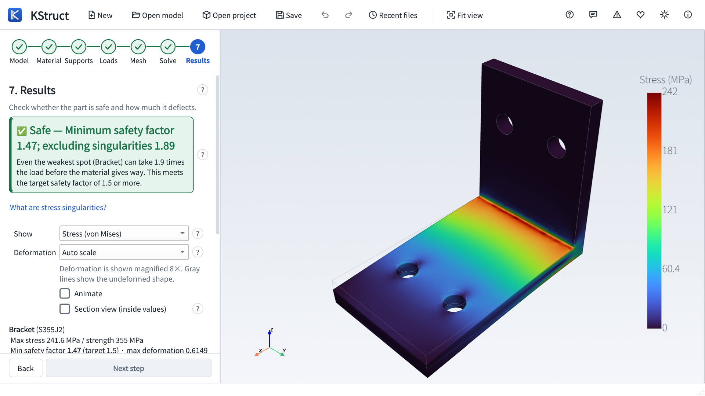
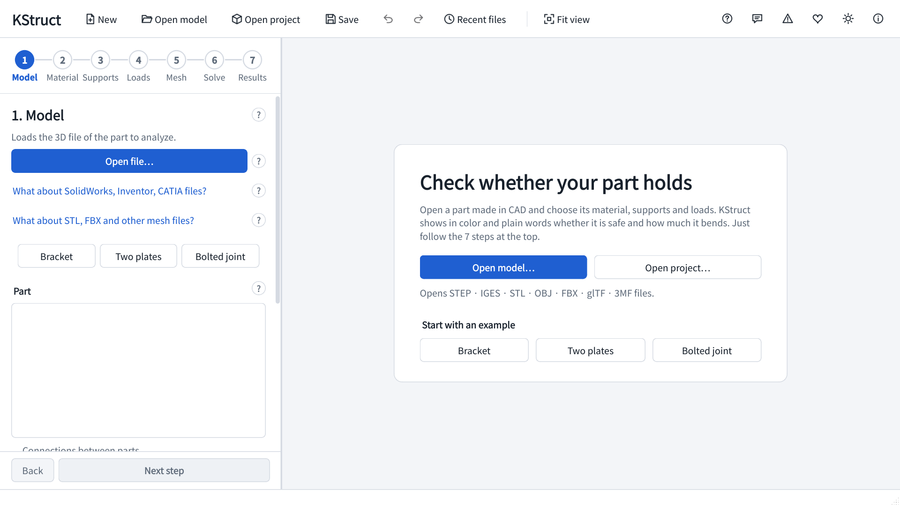
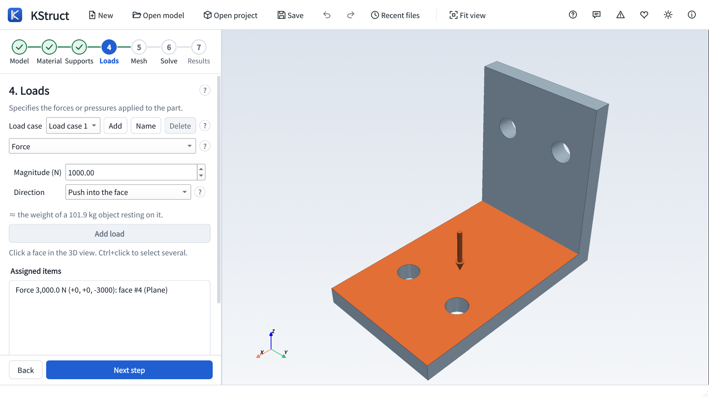
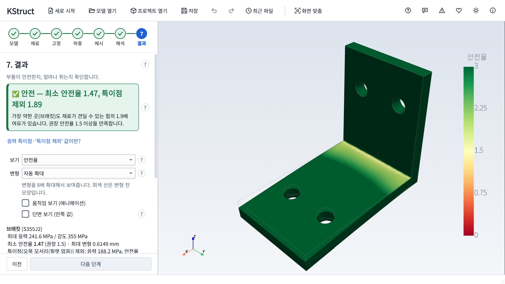
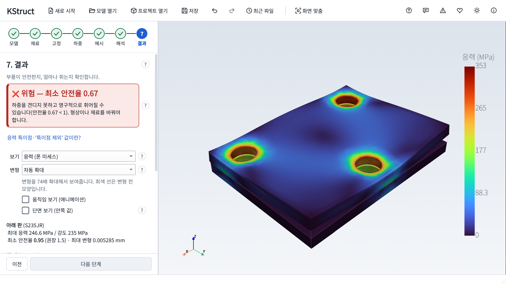
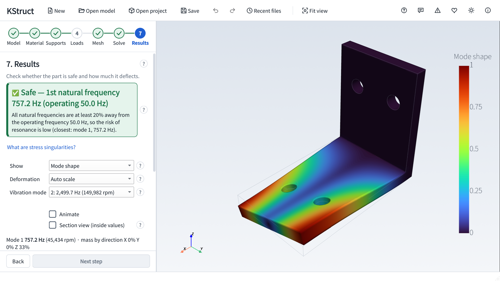
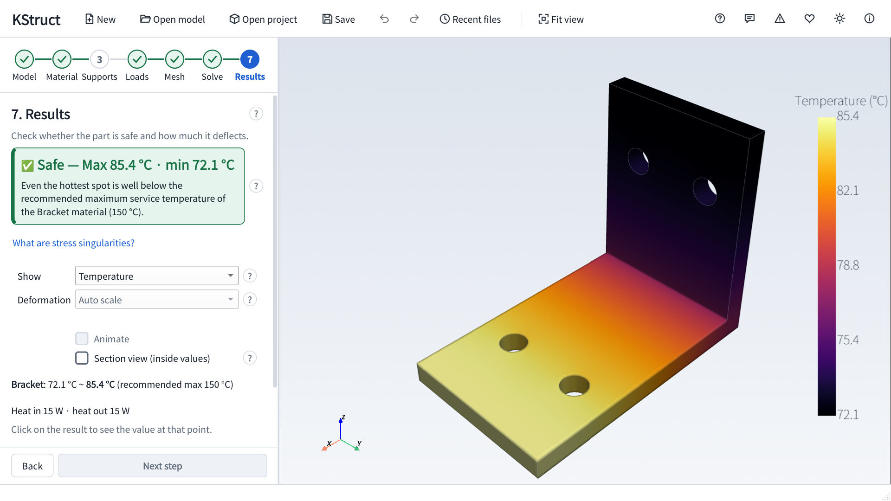
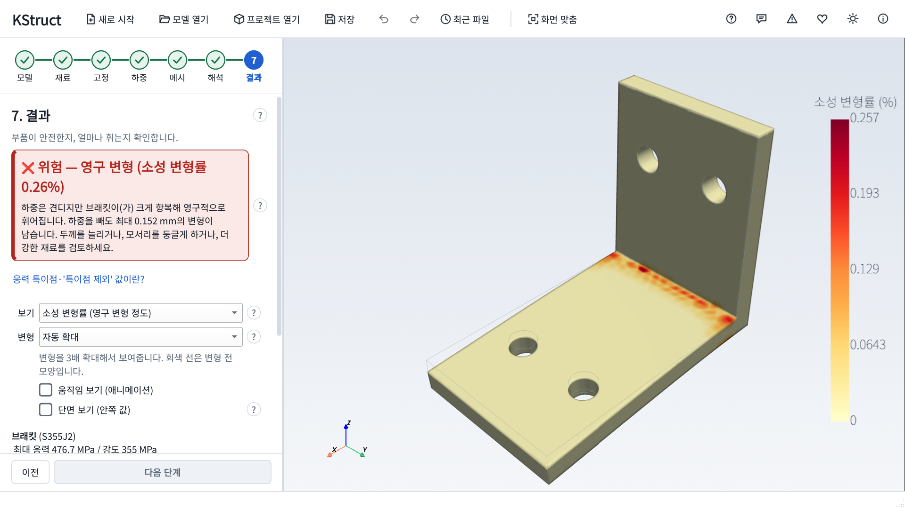
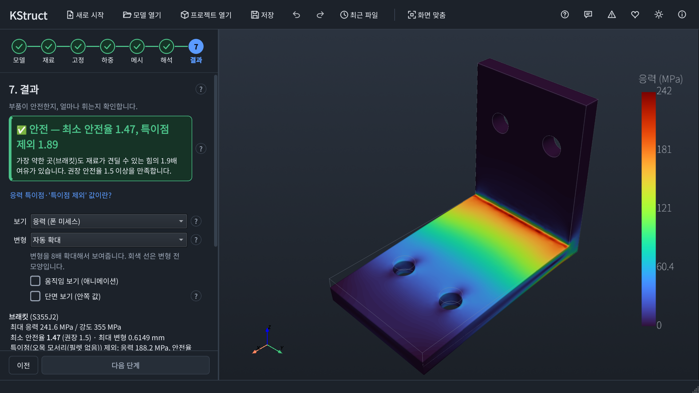

# KStruct — 누구나 쓰는 부품 강도 해석

**CAD 모델을 열고 7단계만 따라 하면, 부품이 견디는지 색과 쉬운 말로 알려 주는 3D 구조해석 프로그램**



KStruct는 기계 부품을 설계하는 사람이 유한요소해석(FEA) 전문 지식 없이도 "이 부품이 이 힘을 견디는가?"를
확인할 수 있게 만든 데스크톱 앱입니다. 재료·고정·하중을 3D 화면에서 클릭으로 지정하면 메시 생성과 계산은
자동으로 하고, 결과는 **✅ 안전 / ⚠ 주의 / ❌ 위험** 판정과 이유, 고칠 방법까지 한국어로 설명합니다.

- **분야**: 엔지니어링 · CAD/CAE · 기계 설계
- **지원 OS**: Windows 10/11 (64비트), macOS 14 이상 (Apple Silicon), Linux (x86-64)
- **언어**: 한국어
- **가격**: 무료 (오픈소스, MIT 라이선스)
- **개발**: MinaryHub · [github.com/MinaryHub/KStruct](https://github.com/MinaryHub/KStruct)

## 주요 기능

- **7단계 안내** — 모델 열기 → 재료 → 고정 → 하중 → 메시 → 해석 → 결과. 모든 버튼과 입력칸에 `?` 도움말
- **쉬운 판정** — 안전율과 권장 기준을 비교해 판정하고, 메시를 바꿔도 값이 계속 커지는 날카로운 모서리(응력 특이점)는 자동으로 찾아 따로 알려 줌
- **강도** — 응력·변형·안전율, 열응력, 반복 하중 피로 수명, 여러 하중 케이스 중 가장 불리한 경우
- **항복 이후·큰 변형** — 재료가 항복한 뒤의 영구 변형과 부품이 무너지는 하중, 많이 휘는 얇은 부품
- **진동** — 고유진동수와 진동 모양, 운전 속도와의 공진 판정
- **좌굴** — 눌리는 부품이 옆으로 휘어 무너지는 하중
- **열** — 열 입력·대류·복사에 의한 온도 분포, 시간에 따른 온도 변화
- **어셈블리** — 맞닿은 면 자동 접합, 접촉(떨어지고 미끄러짐, 마찰), 볼트 체결(예압·축력·전단)
- **보고서** — PDF 보고서, CSV·VTU 내보내기, 이전 해석과 비교
- **편의** — 실행 취소/다시 실행, 자동 저장과 복구, 밝은/어두운 화면, 해석 전 예상 시간, 자동 업데이트

## 화면

| | |
|---|---|
|  시작 화면 |  3D 화면에서 면을 클릭해 고정·하중 지정 |
|  안전율 지도 |  볼트 체결과 접촉 |
|  고유진동수와 진동 모양 |  온도 분포 |
|  항복 이후 영구 변형 |  어두운 화면 |

앱 등록용 원본(1920×1080, 2880×1800)과 장면별 설명 문구는 [docs/screenshots](docs/screenshots/README.md)에 있습니다.

## 지원하는 것

| 항목 | 내용 |
|---|---|
| 불러오기 | STEP·IGES(권장), STL·OBJ·FBX·glTF·3MF. SolidWorks·Inventor·CATIA 원본은 각 프로그램에서 STEP으로 저장 |
| 재료 | 강·스테인리스·알루미늄·주철·티타늄·구리·플라스틱 22종 + 사용자 재료. ISO·EN·KS·JIS·ASTM·GB 명칭 |
| 고정 | 완전 고정, 미끄럼 지지, 핀 지지, 강제 변위, 탄성 지지 |
| 하중 | 힘, 압력, 자중, 원격 하중, 모멘트, 토크, 베어링 하중, 원심력, 볼트 예압, 온도 변화, 고정 온도, 열 입력, 대류, 복사 |
| 메시 | 2차 사면체 자동 생성, 얇은 벽은 두께 방향 요소 수 확보, 원하는 면만 세밀하게 |
| 단위 | SI(mm·N·MPa) / 미국 단위(in·lbf·psi) |

모든 해석 기능은 이론해(교과서 공식)와 비교하는 자동 테스트로 검증합니다.

## 설치

[Releases](https://github.com/MinaryHub/KStruct/releases/latest)에서 운영체제에 맞는 파일을 받습니다.

| OS | 파일 | 설치 |
|---|---|---|
| Windows | `KStruct-Setup-<버전>.exe` | 실행 후 안내에 따라 설치 |
| macOS | `KStruct-<버전>-macOS.dmg` | 열어서 KStruct를 응용 프로그램 폴더로 끌어다 놓기 |
| Linux | `KStruct-<버전>-linux-x86_64.tar.gz` | 압축을 풀고 `KStruct/KStruct` 실행 |

각 릴리스의 `SHA256SUMS.txt`로 받은 파일을 확인할 수 있습니다. 설치한 뒤에는 앱이 새 버전을 알려 주고
그 자리에서 업데이트합니다.

**권장 사양**: 64비트 CPU 4코어 이상, 메모리 8 GB 이상(큰 모델·세밀한 메시는 16 GB), 디스크 1 GB, OpenGL 3.2를 지원하는 그래픽.

## 개인정보와 네트워크

- 계정·로그인·사용 통계 수집이 **없습니다**. 모델과 결과는 내 컴퓨터에만 저장됩니다.
- 네트워크는 **업데이트 확인**(GitHub Releases, 하루 한 번, 업데이트 창에서 끌 수 있음)에만 씁니다.
- '문의하기'는 브라우저에서 GitHub 이슈 작성 화면을 열 뿐이며, 사용자가 내용을 확인하고 직접 올릴 때만 전달됩니다.
- '문제 보고'는 로그와 프로젝트를 zip 파일로 **내 컴퓨터에 저장**만 합니다(자동 전송 없음).

## 지원

- 문의·오류 신고: 앱의 **문의하기**(💬) 또는 [GitHub Issues](https://github.com/MinaryHub/KStruct/issues)
- 오류가 나면 앱의 **문제 보고**로 로그와 프로젝트를 묶어 첨부할 수 있습니다.
- 후원: [GitHub Sponsors](https://github.com/sponsors/MinaryHub)

## 주의

해석 결과는 설계 검토를 돕는 **참고 자료**입니다. 실제 제작·사용 여부는 자격을 갖춘 기술자가 최종 판단해야
합니다. 결과 화면과 보고서에도 같은 고지가 표시됩니다.

## 라이선스

KStruct는 [MIT 라이선스](LICENSE)로 배포됩니다. 누구나 무료로 사용·수정·재배포할 수 있으며, 저작권 고지와
라이선스 문구를 함께 넣으면 됩니다. 함께 배포되는 오픈소스 구성요소(Qt/PySide6, Open CASCADE, Netgen 등)는
각자의 라이선스를 따르며 [THIRD_PARTY_NOTICES.md](THIRD_PARTY_NOTICES.md)에 정리되어 있습니다.

## English

**KStruct** is a desktop finite-element analysis app for mechanical parts, made for people who are not
simulation experts. Open a CAD model (STEP, IGES, STL…), pick a material, click the fixed faces and the
loads, and KStruct meshes and solves automatically, then explains in plain language whether the part is
safe, where it is weakest and what to change. It covers static strength (with thermal stress and
fatigue), yielding and large deformation, vibration, buckling, steady and transient heat transfer,
contact with friction and bolted joints, and writes PDF reports. Free and open source (MIT License); Windows, macOS (Apple Silicon)
and Linux. The user interface is in Korean.

## 개발

```
uv sync                            # 의존성 설치 (Python 3.12)
uv run kstruct                     # 실행
uv run pytest                      # 테스트 (이론해 비교 검증 포함)
uv run python packaging/build.py   # 설치 파일 만들기
```

구조와 개발 규칙은 [CLAUDE.md](CLAUDE.md), 기능 검토와 계획은 [docs/ROADMAP.md](docs/ROADMAP.md),
릴리스 방법은 [docs/RELEASE.md](docs/RELEASE.md)에 있습니다. 사용된 오픈소스 구성요소와 라이선스는
[THIRD_PARTY_NOTICES.md](THIRD_PARTY_NOTICES.md)를 참고하세요.
